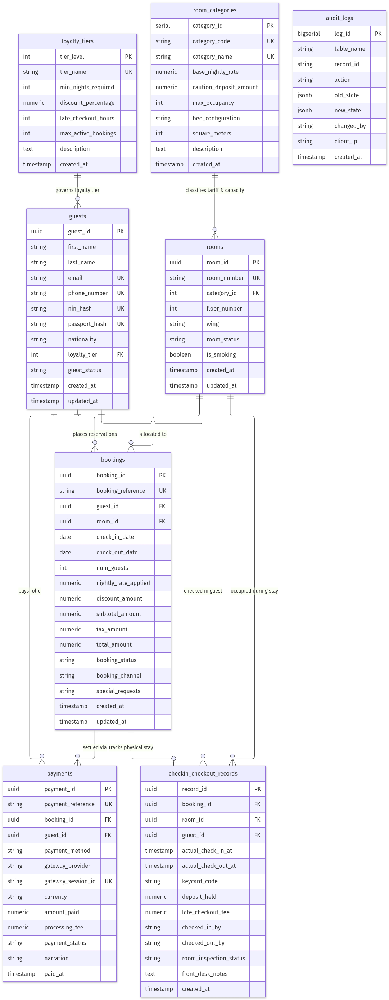
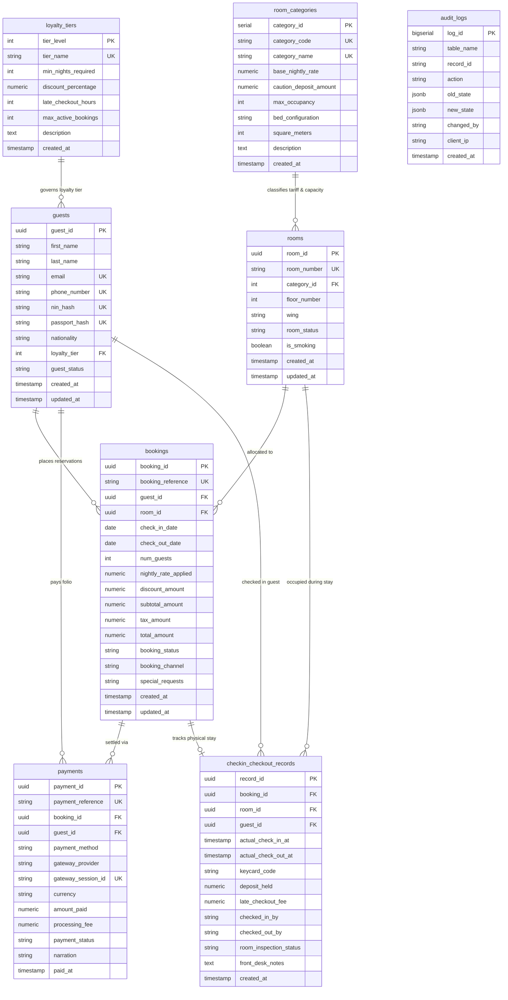

# Portfolio 1: Database Design and Relational Modelling

**Course:** MIT 8103 – Advanced Database Systems  
**Academic Session:** 2026/2027  
**Case Study:** EkoStay Hospitality Limited (Hotel Reservation, Property Management & Smart Room System)  
**Deliverable:** Relational Schema, Normalisation Analysis, ER Diagram, Constraints & Baseline Dataset  
**Component Score Weight:** 7 Marks  
**Author:** Rabiu Sekinah (`301870666`)  

---

## 1. Project Background & Case Study Selection

For this Continuous Assessment, I selected **EkoStay Hospitality Limited** as my core case study. EkoStay is an enterprise hotel reservation and property management platform operating across Nigeria's key commercial hubs—Lagos (Victoria Island and Ikeja), Abuja (Maitama), and Port Harcourt (GRA)—modeled on high-occupancy hospitality operators such as Eko Hotels & Suites, Transcorp Hilton, and Marriott Lagos.

I chose a hotel reservation and property management system because hospitality databases introduce rich, real-world relational and operational constraints that test every aspect of advanced database engineering:
- **Date-Range Inventory Allocation:** Preventing overlapping double-bookings across concurrent online and walk-in channels while enforcing room capacity ceilings.
- **Multi-Tier Tariff & Tax Rules:** Separating standardized room categories (`room_categories`) from physical rooms (`rooms`), applying loyalty tier discounts (`loyalty_tiers`), and computing statutory Nigerian hospitality taxes (7.5% VAT + 5% State Consumption Tax = 12.5%).
- **Operational Housekeeping & Front-Desk Lifecycle:** Enforcing physical room states (`AVAILABLE`, `OCCUPIED`, `DIRTY_CLEANING`, `OUT_OF_ORDER`), RFID/BLE keycard issuance, and refundable caution deposit tracking (`checkin_checkout_records`).
- **Immutable Forensic Auditing:** Trigger-driven JSONB change-data-capture (`audit_logs`) for room status transitions and reservation total modifications.

This milestone establishes the normalized relational foundation (in Boyce-Codd Normal Form) that is used consistently across all five portfolio components.

---

## 2. Entity-Relationship (ER) Diagram

The system architecture models eight core entities organized around guest identity and loyalty, room categories and physical inventory, reservation folios, gateway payments, front-desk stay records, and immutable auditing.



<details>
<summary>Click to view Mermaid ER diagram source code</summary>


</details>

---

## 3. Relational Schema & Mathematical Notation

The relational model is formally expressed below, with **primary keys underlined** and foreign keys denoted with an asterisk ($\text{FK}^*$):

1. **$\text{LOYALTY\_TIERS}$**  
   $(\underline{\text{tier\_level}}, \text{tier\_name}, \text{min\_nights\_required}, \text{discount\_percentage}, \text{late\_checkout\_hours}, \text{max\_active\_bookings}, \text{description}, \text{created\_at})$

2. **$\text{GUESTS}$**  
   $(\underline{\text{guest\_id}}, \text{first\_name}, \text{last\_name}, \text{email}, \text{phone\_number}, \text{nin\_hash}, \text{passport\_hash}, \text{nationality}, \text{loyalty\_tier}^*, \text{guest\_status}, \text{created\_at}, \text{updated\_at})$  
   - $\text{Foreign Key: } \text{loyalty\_tier} \to \text{LOYALTY\_TIERS}(\text{tier\_level})$

3. **$\text{ROOM\_CATEGORIES}$**  
   $(\underline{\text{category\_id}}, \text{category\_code}, \text{category\_name}, \text{base\_nightly\_rate}, \text{caution\_deposit\_amount}, \text{max\_occupancy}, \text{bed\_configuration}, \text{square\_meters}, \text{description}, \text{created\_at})$

4. **$\text{ROOMS}$**  
   $(\underline{\text{room\_id}}, \text{room\_number}, \text{category\_id}^*, \text{floor\_number}, \text{wing}, \text{room\_status}, \text{is\_smoking}, \text{created\_at}, \text{updated\_at})$  
   - $\text{Foreign Key: } \text{category\_id} \to \text{ROOM\_CATEGORIES}(\text{category\_id})$

5. **$\text{BOOKINGS}$**  
   $(\underline{\text{booking\_id}}, \text{booking\_reference}, \text{guest\_id}^*, \text{room\_id}^*, \text{check\_in\_date}, \text{check\_out\_date}, \text{num\_guests}, \text{nightly\_rate\_applied}, \text{discount\_amount}, \text{subtotal\_amount}, \text{tax\_amount}, \text{total\_amount}, \text{booking\_status}, \text{booking\_channel}, \text{special\_requests}, \text{created\_at}, \text{updated\_at})$  
   - $\text{Foreign Key: } \text{guest\_id} \to \text{GUESTS}(\text{guest\_id})$  
   - $\text{Foreign Key: } \text{room\_id} \to \text{ROOMS}(\text{room\_id})$

6. **$\text{PAYMENTS}$**  
   $(\underline{\text{payment\_id}}, \text{payment\_reference}, \text{booking\_id}^*, \text{guest\_id}^*, \text{payment\_method}, \text{gateway\_provider}, \text{gateway\_session\_id}, \text{currency}, \text{amount\_paid}, \text{processing\_fee}, \text{payment\_status}, \text{narration}, \text{paid\_at})$  
   - $\text{Foreign Key: } \text{booking\_id} \to \text{BOOKINGS}(\text{booking\_id})$  
   - $\text{Foreign Key: } \text{guest\_id} \to \text{GUESTS}(\text{guest\_id})$

7. **$\text{CHECKIN\_CHECKOUT\_RECORDS}$**  
   $(\underline{\text{record\_id}}, \text{booking\_id}^*, \text{room\_id}^*, \text{guest\_id}^*, \text{actual\_check\_in\_at}, \text{actual\_check\_out\_at}, \text{keycard\_code}, \text{deposit\_held}, \text{late\_checkout\_fee}, \text{checked\_in\_by}, \text{checked\_out\_by}, \text{room\_inspection\_status}, \text{front\_desk\_notes}, \text{created\_at})$  
   - $\text{Foreign Key: } \text{booking\_id} \to \text{BOOKINGS}(\text{booking\_id})$  
   - $\text{Foreign Key: } \text{room\_id} \to \text{ROOMS}(\text{room\_id})$  
   - $\text{Foreign Key: } \text{guest\_id} \to \text{GUESTS}(\text{guest\_id})$

8. **$\text{AUDIT\_LOGS}$**  
   $(\underline{\text{log\_id}}, \text{table\_name}, \text{record\_id}, \text{action}, \text{old\_state}, \text{new\_state}, \text{changed\_by}, \text{client\_ip}, \text{created\_at})$

---

## 4. Normalisation Analysis (UNF to BCNF)

To eliminate data redundancy and prevent insertion, update, and deletion anomalies, the EkoStay schema was systematically refined from Unnormalised Form (UNF) through to Boyce-Codd Normal Form (BCNF):

### 4.1 Unnormalised Form (UNF)
In a flat, unnormalised hotel register spreadsheet, guest identity, loyalty perks, room specifications, booking dates, payments, and check-in logs are stored together:

```text
UNF = {guest_name, email, phone, nin, loyalty_tier, discount_pct, late_checkout_hrs,
       reservations: [{booking_ref, room_number, wing, category_name, base_rate, max_occupancy,
                       check_in, check_out, total_amount,
                       payments: [{pay_ref, gateway, amount, status}],
                       stay_log: {actual_checkin, actual_checkout, keycard_code, deposit_held}}]}
```

**Anomalies Present in UNF:**
- **Repeating Groups:** Nested arrays of reservations and payment attempts inside a single guest row.
- **Update Anomaly:** Updating the base nightly rate of a `Diplomatic Suite` from ₦280,000 to ₦310,000 requires updating every historical and future booking row for every room in that category.
- **Insertion Anomaly:** A newly constructed hotel room (`E502`) or room category cannot be added to the database until a guest places a booking for it.
- **Deletion Anomaly:** Deleting a cancelled booking for the only room in a category inadvertently erases the category's tariff and occupancy metadata.

### 4.2 First Normal Form (1NF)
**Requirement:** Every attribute must contain only atomic (indivisible) values, and repeating groups must be eliminated with a primary key identifying each tuple.
- **Resolution:**
  - Repeating groups (`reservations`, `payments`, `stay_log`) were extracted into separate relational tables.
  - Composite names (`guest_name`) were split into atomic columns (`first_name`, `last_name`).
  - Surrogate primary keys (`guest_id`, `room_id`, `booking_id`, `payment_id`, `record_id`) were defined.

### 4.3 Second Normal Form (2NF)
**Requirement:** The relation must be in 1NF and every non-key attribute must be fully functionally dependent on the *entire* primary key (no partial dependencies on a composite key).
- **Resolution:**
  - In a composite-key reservation table keyed by $(\text{guest\_id}, \text{room\_id}, \text{check\_in\_date})$, attributes like `first_name` and `phone_number` depend only on `guest_id`, while `wing`, `floor_number`, and `room_status` depend only on `room_id`.
  - Decomposing into `GUESTS`, `ROOMS`, and `BOOKINGS` with single-attribute primary keys ensures every non-key attribute is fully dependent on its relation's primary key.

### 4.4 Third Normal Form (3NF)
**Requirement:** The relation must be in 2NF and contain no transitive functional dependencies ($X \to Y \to Z$ where $X$ is the primary key and $Y$ is a non-key attribute).
- **Resolution:**
  - **Transitive Dependency 1 (Rooms $\to$ Categories):** In `ROOMS`, the dependency chain existed:
    $$\text{room\_id} \to \text{category\_id} \to (\text{category\_name}, \text{base\_nightly\_rate}, \text{caution\_deposit\_amount}, \text{max\_occupancy}, \text{bed\_configuration})$$
    This was resolved by extracting tariff and capacity attributes into `ROOM_CATEGORIES`, leaving `category_id` as a foreign key in `ROOMS`.
  - **Transitive Dependency 2 (Guests $\to$ Loyalty Tiers):** In `GUESTS`, the dependency chain existed:
    $$\text{guest\_id} \to \text{loyalty\_tier} \to (\text{tier\_name}, \text{discount\_percentage}, \text{late\_checkout\_hours}, \text{max\_active\_bookings})$$
    This was resolved by isolating tier benefits into `LOYALTY_TIERS`.
  - **Separating Operational Stay Logs:** Physical check-in attributes (`actual_check_in_at`, `keycard_code`, `deposit_held`, `room_inspection_status`) do not exist for future or cancelled bookings. Isolating them into `CHECKIN_CHECKOUT_RECORDS` eliminates sparse NULL columns on `BOOKINGS`.

### 4.5 Boyce-Codd Normal Form (BCNF)
**Requirement:** For every non-trivial functional dependency $X \to Y$ in a relation, $X$ must be a superkey.
- **Resolution:**
  - In `ROOMS`, both `room_id` (PK) and `room_number` (Unique) are candidate keys; all attributes (`category_id`, `floor_number`, `wing`, `room_status`) depend solely on these superkeys.
  - In `ROOM_CATEGORIES`, `category_id` (PK), `category_code` (Unique), and `category_name` (Unique) are all superkeys.
  - In `CHECKIN_CHECKOUT_RECORDS`, `record_id` (PK) and `booking_id` (1:1 Unique FK) are superkeys.
  - Every determinant across all 8 tables is a candidate key, confirming full **BCNF compliance**.

---

## 5. Integrity Constraints & Business Logic

### 5.1 Domain & Check Constraints
- **Room Number Format Validation:** Enforces wing-letter + 3-digit numbering (`A101`, `D402`):
  `CHECK (room_number ~ '^[A-Z][0-9]{3}$')`
- **Stay Date Range Integrity:** Guarantees check-out is strictly after check-in (minimum 1 night):
  `CHECK (check_out_date > check_in_date)`
- **Nigerian Phone Format:** Enforces E.164 Nigerian mobile format:
  `CHECK (phone_number ~ '^\+234[0-9]{10}$')`
- **Monetary Positivity & Non-Negativity:** Ensures tariffs, subtotals, and payment amounts are strictly positive (`> 0.0000`) while discounts, taxes, and processing fees are non-negative (`>= 0.0000`).

### 5.2 Referential Integrity & Cascade Rules
- `ON DELETE RESTRICT` on `rooms(category_id)`, `bookings(guest_id)`, `bookings(room_id)`, and `payments(booking_id)`: Prevents accidental deletion of guests, rooms, or room categories that have historical reservation or financial records.

### 5.3 Active Triggers & Automated Forensics
1. **Operational Booking Validation Trigger (`trg_validate_booking_rules`):**
   - Rejects reservations on rooms in `OUT_OF_ORDER` maintenance status.
   - Rejects reservations when `num_guests` exceeds the room category's `max_occupancy`.
   - Rejects reservations from `BLACKLISTED` guests.
   - Rejects overlapping active reservations (`CONFIRMED` or `CHECKED_IN`) on the same room where `existing.check_in_date < NEW.check_out_date AND existing.check_out_date > NEW.check_in_date`.
2. **Automated JSONB Audit Logging (`trg_audit_room_mutations` & `trg_audit_booking_mutations`):**
   - Intercepts updates to `rooms` and `bookings`, recording `old_state` and `new_state` JSONB snapshots into `audit_logs` along with the database user and client IP.

---

## 6. Seed Dataset & Testing Evidence

The baseline seed dataset (`03-seed-data.sql`) populates realistic Nigerian hospitality records:
- **4 Loyalty Tiers:** `Classic Guest` (0% discount) through `Platinum Royal` (15% discount, 4-hour late check-out).
- **5 Room Categories:** From `Classic Standard King` (₦85,000/night) to `Presidential Penthouse` (₦650,000/night).
- **12 Guests:** Including verified NIN/Passport SHA-256 hashes and one `BLACKLISTED` guest (`Kunle Coker`) for negative constraint testing.
- **14 Rooms:** Spanning `GARDEN_WING`, `LAGOON_WING`, `ATLANTIC_WING`, and `EXECUTIVE_TOWER`, including one `OUT_OF_ORDER` room (`C303`).
- **8 Bookings, 8 Payments & 5 Check-In/Out Records:** Covering completed stays, active in-house guests, future confirmed penthouse bookings, and a cancelled OTA booking due to an Interswitch POS timeout.

### Test Suite Execution Summary (`04-verification-tests.sql`):
1. **Entity Count Verification:** Confirms exact baseline counts across all 8 tables.
2. **Inventory & Tariff Join:** Verifies `rooms` $\to$ `room_categories` join integrity.
3. **Folio & Payment Reconciliation:** Confirms 100% alignment between booking totals and gateway settlements.
4. **Negative Constraint Assertions (`evidence/verification-test-output.log`):**
   - **Test 4A:** Check-out date prior to check-in date (`2026-12-08 < 2026-12-10`) rejected by `chk_booking_dates`.
   - **Test 4B:** Malformed room number (`101A`) rejected by `chk_room_number_format`.
   - **Test 4C:** Duplicate phone number (`+2348011234567`) rejected by unique constraint.
   - **Test 4D:** Reservation attempt on `OUT_OF_ORDER` room `C303` rejected by `trg_validate_booking_rules`.

---

## 7. Instructions for Execution & Docker Environment

### Option A: Using Docker Compose (Recommended)
The repository includes a root `docker-compose.yml` pre-configured to launch PostgreSQL 16 on host port `5436` and automatically initialize `01-schema.sql`, `02-constraints.sql`, and `03-seed-data.sql` on startup.

```bash
# 1. Start the PostgreSQL container (from repository root)
docker compose up -d ekostay-postgres

# 2. Execute the verification test suite
docker compose exec -T ekostay-postgres psql -U ekostay_admin -d ekostay_db -f /portfolio-1/04-verification-tests.sql

# 3. Connect via interactive psql shell
docker compose exec -it ekostay-postgres psql -U ekostay_admin -d ekostay_db
```

### Database Connection Credentials
- **Host:** `localhost`
- **Port:** `5436` (Docker) or `5432` (Container)
- **Database:** `ekostay_db`
- **Username:** `ekostay_admin`
- **Password:** `EkoStaySecure2026!`
- **Connection URL Format:** `postgresql://<username>:<password>@localhost:5436/ekostay_db`

---

## 8. Technical Reflection & Practical Debugging Log

### 8.1 Key Architectural Decisions
- **Separating `rooms` and `room_categories`:**  
  Storing `base_nightly_rate`, `caution_deposit_amount`, and `max_occupancy` directly inside the `rooms` table would duplicate tariff metadata across hundreds of rooms and cause update anomalies during seasonal rate adjustments. Normalizing these attributes into `room_categories` ensures 3NF/BCNF compliance while preserving `nightly_rate_applied` on `bookings` so historical folios remain immutable when base tariffs change.
- **Separating `bookings` and `checkin_checkout_records`:**  
  Not every booking results in a physical stay (e.g., future reservations, cancellations, or no-shows). Isolating physical front-desk operations (`actual_check_in_at`, `keycard_code`, `deposit_held`, `room_inspection_status`) into a 1:1 child relation prevents NULL-heavy rows in `bookings`.

### 8.2 Practical Bug Encountered & Resolved (Serial Sequence Synchronization)
During initial seed testing of `room_categories`, explicitly inserting `category_id` values `1` through `5` left PostgreSQL's underlying sequence `room_categories_category_id_seq` at `1`. A subsequent test insert without an explicit `category_id` raised:
```text
ERROR: duplicate key value violates unique constraint "room_categories_pkey"
DETAIL: Key (category_id)=(1) already exists.
```
**Resolution:**  
I added `SELECT setval('room_categories_category_id_seq', 5, true);` immediately after seeding `room_categories` in `03-seed-data.sql`, synchronizing the sequence counter with the highest seeded ID.

---

## 9. Academic Integrity and AI Use Declaration

*(In accordance with Section 11 of the Continuous Assessment Syllabus)*

1. **AI Tools Used:** Claude / AI Programming Assistant
2. **Purpose:**
   - Reviewing PostgreSQL 16 trigger syntax for overlapping date-range checks (`check_in_date < NEW.check_out_date AND check_out_date > NEW.check_in_date`).
   - Structuring the Mermaid ER diagram syntax for visual export.
3. **Student Verification & Ownership:**
   - All hospitality entities, Nigerian statutory tax rules (12.5% combined VAT and State Consumption Tax), loyalty tiers, and normalization proofs (UNF to BCNF) were designed by me.
   - I configured the Docker environment, executed the schema and verification suite against the live PostgreSQL 16 container, and verified all negative constraint assertions.
