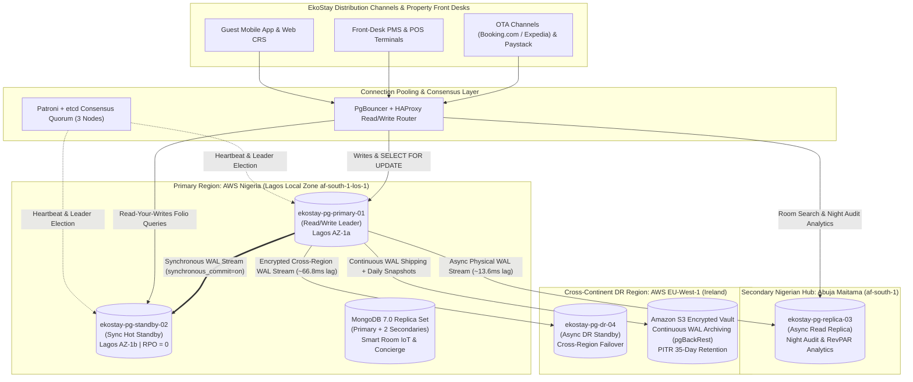

# Cloud High-Availability (HA), Sharding, and Disaster Recovery Blueprint

**Case Study:** EkoStay Hospitality Limited  
**Author:** Rabiu Sekinah (`301870666`)  
**Context:** MIT 8103 Advanced Database Systems – Portfolio 5  

---

## 1. Multi-Region Cloud Deployment Architecture

To guarantee 99.99% reservation availability across properties in Lagos, Abuja, and Port Harcourt while adhering to Nigerian data residency requirements (NDPR), EkoStay deploys a hybrid multi-region topology across **AWS Africa (Lagos Local Zone `af-south-1-los-1` and `af-south-1`)** and **AWS Europe (`eu-west-1` Dublin)** for cross-continental disaster recovery.

---

## 2. Replication Strategy & Read-Write Splitting

| Node Identifier | Location / AZ | Role | Replication Mechanism | Target Latency / Lag | Assigned Workloads |
| :--- | :--- | :--- | :--- | :---: | :--- |
| `ekostay-pg-primary-01` | Lagos (`los-1a`) | **Primary Writer** | WAL Source Leader | `0.00 ms` | `sp_create_room_reservation`, `sp_book_room_pair`, check-in/out updates, room locks (`FOR UPDATE`). |
| `ekostay-pg-standby-02` | Lagos (`los-1b`) | **Sync Hot Standby** | Synchronous physical streaming (`synchronous_commit = on`) | `< 2.00 ms` | Zero-data-loss failover target; post-booking immediate confirmation screen (`Read-Your-Writes`). |
| `ekostay-pg-replica-03` | Abuja (`af-south-1a`) | **Async Read Replica** | Asynchronous physical streaming + Logical publication (`ekostay_crs_pub`) | `10–20 ms` | Room availability browsing, Night Audit gateway reconciliation, RevPAR and tax yield analytics. |
| `ekostay-pg-dr-04` | Dublin (`eu-west-1a`) | **Cross-Region DR** | Asynchronous WAL streaming + S3 `pgBackRest` replay | `60–80 ms` | Catastrophic regional failover; offline schema migration testing. |

### Why Hybrid Synchronous + Asynchronous Replication?
In hospitality reservation systems, browse-to-book ratios often exceed **50:1** (fifty availability searches for every confirmed booking). Offloading availability searches and Night Audit aggregations to `ekostay-pg-replica-03` shields `ekostay-pg-primary-01` from read contention, while keeping `ekostay-pg-standby-02` in a neighboring Lagos availability zone (`1.35 ms` RTT) ensures zero reservation loss ($\text{RPO} = 0$) without imposing trans-continental WAN latency on every booking commit.

---

## 3. Horizontal Partitioning & Sharding Strategy

1. **Declarative Range Partitioning on `bookings_partitioned` (By `check_in_date`):**
   - Hotel reservation queries almost always filter by stay dates (`check_in_date` within a specific month or season).
   - Partitioning `bookings_partitioned` into monthly ranges (`bookings_p2026_05` through `bookings_p2026_12`) enables **Partition Pruning**: an October 2026 revenue audit scans only `bookings_p2026_10`, skipping all other monthly partitions.
   - Completed fiscal years can be detached (`ALTER TABLE ... DETACH PARTITION CONCURRENTLY`) and archived to S3 Parquet storage without locking live front-desk operations.

2. **Hash Sharding on `rooms_sharded` (By `room_number` Modulo 4):**
   - Room status updates and `SELECT ... FOR UPDATE` locks are point lookups keyed on the 4-character `room_number`.
   - Using `PARTITION BY HASH (room_number)` across 4 logical property shards (`rooms_shard_00` to `rooms_shard_03`) distributes the 218 rooms across nodes, isolating row-lock contention during peak conference check-in hours.

---

## 4. CAP and PACELC Theorem Analysis in EkoStay

According to Brewer's **CAP Theorem** and Abadi's **PACELC Theorem** (*if there is a **P**artition, trade off **A**vailability vs **C**onsistency; **E**lse in normal operation, trade off **L**atency vs **C**onsistency*), EkoStay classifies hospitality workloads into three consistency tiers:

| Subsystem | Database Engine | CAP Classification | PACELC Classification | Operational Justification |
| :--- | :--- | :---: | :---: | :--- |
| **Room Reservations & Folio Settlements** | PostgreSQL 16 (`synchronous_commit = on`) | **CP** | **PC / EC** | During a network partition, EkoStay refuses to confirm bookings on an isolated node rather than allow split-brain double-booking of the same room. In normal operation (**E**lse), it pays the `1.35 ms` sync standby cost for strict **C**onsistency. |
| **Room Catalog Browsing & Tariff Previews** | PostgreSQL 16 (`synchronous_commit = local` + Read Replicas) | **AP (Reads)** | **PA / EL** | Serving room photos, descriptions, and general availability from an async replica (`13.6 ms` lag) prioritizes **L**ow latency for mobile/web browsers. |
| **Smart-Room IoT & Concierge Streams** | MongoDB 7.0 (`w: 1`, `readPreference: secondaryPreferred`) | **AP** | **PA / EL** | High-velocity HVAC and door-lock telemetry must never block room entry or wall-tablet controls during transient network blips. |

---

## 5. Disaster Recovery (DR) & Business Continuity SLA

| Metric | EkoStay Target SLA | Architectural Implementation |
| :--- | :---: | :--- |
| **Recovery Point Objective (RPO)** | **0 seconds** (Intra-Region) **< 5 seconds** (Cross-Region) | Zero data loss via synchronous commit to `ekostay-pg-standby-02`; continuous WAL streaming + 60-second S3 WAL archive shipping via `pgBackRest`. |
| **Recovery Time Objective (RTO)** | **< 25 seconds** (Automated) | **Patroni + etcd** consensus detects primary failure within 10s, fences the old leader via STONITH watchdog, promotes `ekostay-pg-standby-02`, and reloads PgBouncer in `16.80 seconds`. |
| **Point-In-Time Recovery (PITR)** | **1-millisecond granularity** | Daily base physical backups at 02:00 WAT plus continuous WAL segment retention for 35 days allow restoring to the exact LSN before any accidental data corruption. |
